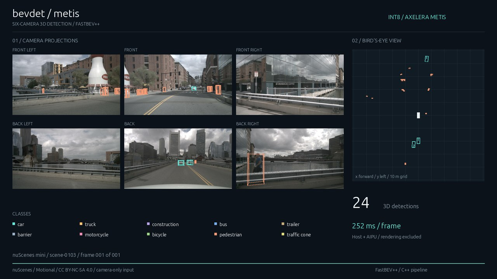

# bevdet-metis

Six-camera, camera-only 3D object detection with [FastBEV++](https://github.com/ymlab/advanced-fastbev), starting from its published ONNX model and targeting Axelera Metis.

This is a modular C++ AxRuntime deployment with a Python ONNX/AxRuntime reference, separate from the upstream training framework. It reads nuScenes camera samples and calibration, predicts oriented 3D boxes, and renders the six camera views alongside a bird's-eye view. Boxes include class, confidence, center, dimensions, yaw and planar velocity.

The C++ implementation keeps preprocessing, quantization, layout conversion, padding, inference, field transforms and decoding separate. This is an unfused baseline for correctness and profiling. Inference runs entirely in C++ using AxRuntime; Python is used for the optional presentation and comparisons. There is no tracking, temporal fusion or frame pipelining.



## Quick start

On this workspace, the existing uv environment and Voyager SDK are reused:

```bash
cd /home/sanket-shah/Desktop/Projects/axelera/bevdet-metis
make setup
make models
make data
make build
make compile                  # Reuses existing compiled stages when unchanged
make demo
make video
make compare
```

The default interpreter is `../deeplsd-metis/.venv/bin/python`. Only Python inference dependencies are added there; the training framework is not installed. On another machine, point `PYTHON` to an existing environment, or create one:

```bash
uv venv --python 3.11 .venv
make setup PYTHON=.venv/bin/python
make models data PYTHON=.venv/bin/python
make demo BACKEND=onnx PYTHON=.venv/bin/python
```

The C++ build requires a C++17 compiler, CMake, pkg-config, OpenCV, yaml-cpp, nlohmann-json, OpenSSL, OpenBLAS and an installed AxRuntime. On Ubuntu, the development packages are:

```bash
sudo apt install build-essential cmake pkg-config libopencv-dev libyaml-cpp-dev \
  nlohmann-json3-dev libssl-dev libopenblas-dev
```

Git, uv and FFmpeg with libx264 are needed for setup and presentation. `make setup` also fetches the pinned upstream source for the independent geometry verification. PyTorch is optional for that comparison and is already available in the shared environment; ordinary ONNX inference needs no PyTorch, MMCV or CUDA. `BACKEND=onnx` runs the Python CPU reference without building C++ or requiring Metis hardware.

## Model and data

`make models` downloads the [official ONNX export](https://drive.google.com/file/d/1qefFlah6PkKPtz0Zgh9aqn0rqITjU2C8/view), checks its SHA-256, and prepares the CPU and Metis partitions. Despite its `fastbev_fp16.onnx` filename, this particular export has FP32 weights, inputs and outputs. Its shared ResNet-50 image encoder processes six `3×256×704` camera images; the BEV grid is `128×128` over approximately `102.4×102.4 m`.

The [original `epoch_20_ema.pth` checkpoint](https://drive.google.com/file/d/1q49_7aR7EWWOCAUK8iE5jfj1JdtL9gJy/view) is available too:

```bash
make checkpoint
```

It is optional; inference and compilation start directly from ONNX. Asset URLs, upstream revision and generated model checksums are recorded in [weights/onnx/provenance.json](weights/onnx/provenance.json).

`make data` downloads the smallest official packaged release, [nuScenes v1.0-mini](https://www.nuscenes.org/nuscenes), verifies the archive, and retains only camera keyframes and metadata:

| Item | Size / count |
| --- | --- |
| Official archive downloaded | 4.17 GB |
| Retained RGB images and JSON | About 449 MB |
| Scenes / six-camera samples / images | 10 / 404 / 2,424 |
| Default demo | `scene-0103`, official `mini_val` |

The archive is removed after successful extraction. LiDAR, radar, maps and sweeps are not retained or required. Calibration and camera poses come from nuScenes metadata; six arbitrary JPEGs without calibration are not a substitute for a rig sample. nuScenes data and derived demo imagery are under CC BY-NC-SA 4.0; see [THIRD_PARTY_NOTICES.md](THIRD_PARTY_NOTICES.md).

### Export correction

The pinned upstream `FastrayTransformer.forward()` applies a sigmoid to depth logits before lifting image features into BEV. `FastBEVTRT.forward()` and the published ONNX omit that sigmoid. The original export is preserved byte-for-byte as `fastbev_fp16.onnx`; the default `fastbev.onnx` restores this one operation without changing weights. The host view transform uses the same sigmoid.

`BACKEND=upstream` runs the unmodified export for comparison. This project does not claim a reproduced nuScenes mAP/NDS result. The correction and the INT8 deployment still need a full accuracy evaluation.

## Commands

| Command | Result |
| --- | --- |
| `make build` | Build `build/bevdet_metis` and the reusable `bevdet_cpp` library |
| `make demo` | C++ detections + one rendered sample, `results/cpp/demo.png` |
| `make video` | C++ detections + 20 samples / 10 seconds, `results/cpp/video.mp4` |
| `make profile` | C++ timings without rendering or encoding |
| `make compare` | Compare C++ with Python AxRuntime on 20 samples and dump/check three tensor traces |
| `make verify` | Same C++ comparison by default |
| `make verify BACKEND=onnx` | Corrected full ONNX vs partitions and upstream geometry |
| `make verify BACKEND=aipu` | Run Metis on the same samples and report INT8/FP32 differences |
| `make calibration` | Cache 32 `mini_train` rig samples / 192 camera images |
| `make compile` | Quantize and compile the CNN stages using Voyager |

```bash
make video FRAMES=30 START=5
make compare FRAMES=20
make demo BACKEND=split
make profile BACKEND=onnx FRAMES=20
make calibration CALIB_FRAMES=64
make compile PART=image
make demo BACKEND=aipu
make video BACKEND=aipu
```

`BACKEND=cpp` is the default. `BACKEND=aipu` selects Python AxRuntime; `onnx`, `split` and `upstream` retain the Python references. Use `CONFIG=path/to/config.yaml` to select a config, `OUTPUT_DIR=results/my_run` for another output directory, and `SDK=/path/to/voyager-sdk` for another SDK installation. `BUILD_DIR` selects a CMake build directory and `AXRUNTIME_ROOT` selects the runtime installation, defaulting to `/opt/axelera`.

Paths inside YAML are relative to the YAML file. The same `configs/default.yaml` is loaded into typed C++ configuration structs and used by Python. It sets model/data directories, scene, CPU threads, score threshold, rotated NMS threshold and maximum detections. Model geometry, normalization and tensor quantization are validated contracts rather than user tuning controls.

Each run saves JSONL frame tokens, predicted boxes and timings, plus a JSON timing summary. Python inference runs additionally include ground-truth annotations. Profile runs use `profile.json` / `profile.jsonl` so they do not overwrite video results. Box centers are in the ego frame at the first camera's timestamp: **x forward, y left, z up**, dimensions **length, width, height**, metres and radians.

To adjust the presentation without repeating inference:

```bash
../deeplsd-metis/.venv/bin/python python/render.py --config configs/default.yaml \
  --detections results/cpp/video.jsonl --output results/cpp/video.mp4
```

`make video` plays at nuScenes' native **2 Hz annotated keyframe rate**. Playback rate is independent of processing throughput. Profiling includes six JPEG reads, image preprocessing, projection-index construction, model execution, geometry and box decoding; it excludes model loading, visualization, JSON export and video encoding. Averages include the first processed frame.

## Metis execution

The camera backbone is shared, not six separate trained networks. The current implementation calls one image model six times, then lifts and combines its features. It executes synchronously to establish a correct baseline before introducing concurrent camera scheduling or frame pipelining.

```text
6 camera images
  → image CNN ×6                         [Metis]
  → depth sigmoid, indexed lift, sum z   [host]
  → BEV backbone                        [Metis]
  → exact bilinear resize + concat      [C++ host]
  → BEV neck                            [Metis]
  → exact bilinear resize               [C++ host]
  → detection head                      [Metis]
  → CenterPoint decode + rotated NMS    [host]
```

Although the learned stages are CNNs, the complete exported graph also contains camera-geometry gathers and two `align_corners` bilinear resizes. SDK 1.7 does not support that resize convention on the AIPU, so these operations stay on the host rather than being replaced with an approximation.

Each compiled CNN requests one Metis core. A shared AxRuntime context owns four model instances, each with its own device connection reserving one core. Input/output shape, padding, scales and zero points are validated against the compiled runtime metadata; quantization parameters are not maintained in YAML. The backbone packs its two feature scales into one terminal output and the host reverses that packing before the exact resize. SDK 1.7 exposes a second physical copy of the backbone input; its ABI binding is explicit and checked before use.

Calibration defaults to 32 uniformly selected, distinct samples from the official eight-scene `mini_train` partition. The default demo scene is held out. Image calibration sees 192 real images; downstream stages see 32 reference feature tensors. Caches and compiled artifacts retain source/model/calibration checksums and compiler settings. This is a bring-up calibration set, not a substitute for a representative deployment dataset.

## C++ modules

The layout follows `lines-metis`: flat headers/sources with `common` and `inference` subfolders. Classes own their state directly; there are no Python bindings or PImpl classes.

| Module | Responsibility |
| --- | --- |
| `Preprocessing` | JPEG reads, Pillow-compatible bicubic resize/crop, normalization, camera alignment and projection indices |
| `AipuContext` | Own the shared AxRuntime context |
| `AipuInference` | Own one model/connection/buffers; separate quantization, layout conversion, padding, execution and output decoding |
| `ViewTransform` | Sigmoid depth probabilities, feature gathering, height reduction and BEV coordinate order |
| `FeatureResize` | Native C++ bilinear resize preserving `align_corners` behavior |
| `Postprocessing` | CenterPoint box decoding, class-scaled rotated NMS |
| `Pipeline` | Own and call the stages in order, returning ego-frame detections |

CPU stages use one contiguous NCHW `Tensor` type. `AipuTensorInfo` describes physical runtime storage. Runtime buffers remain backend-owned; `Process()` outputs are valid until that backend's next call. The pipeline retains its stage results for optional validation dumps.

```cpp
const auto config = bev::LoadConfig("configs/default.yaml");
const bev::Dataset dataset(config.data.directory);
bev::Pipeline pipeline(config);
const auto frame = dataset.frames(config.data.scene, 0, 1).front();
bev::Timings timings;
const auto boxes = pipeline.Process(frame, &timings);
```

Preprocessing preserves the upstream BGR channel convention and Pillow's antialiased bicubic coefficients and integer rounding; OpenCV's cubic filter is not substituted. Projection uses OpenBLAS, matching the reference provider: tiny float32 differences near integer pixel boundaries can otherwise change a voxel's selected feature. Top-K selection preserves the SDK NumPy 1.26 reference's equal-score ordering, which matters for greedy NMS with INT8 score ties. These compatibility routines execute entirely in C++.

## Validation and performance

Validated on Ubuntu 24.04, Ryzen 7 3700X, Voyager compiler 1.7.0 and AxRuntime 1.7.0, using connected Metis hardware. The two Python environments are deliberate: ONNX/data preparation uses the existing uv environment; compilation and AxRuntime use the SDK's own environment without installing packages into it.

- Three real rig samples pass full corrected ONNX versus partitioned ONNX comparison (`rtol=5e-5`, `atol=2e-5`); the largest absolute head difference is `1.15e-5`.
- All 114,688 image/depth projection indices match the unmodified upstream PyTorch implementation on the checked sample. The BEV maximum absolute difference is `1.91e-6`.
- All four compiled CNN stages run in either a standalone C++ process or the Python reference on four reserved Metis cores.
- On 20 `scene-0103` samples, all **775 decoded detections** match Python in class, score, center, yaw and velocity. The largest dimension difference is `4.77e-7 m`.
- Three full tensor traces have bit-identical preprocessed images, projection indices and all six raw heads. Intermediate BEV floats differ by at most `1.44e-6`, without changing the quantized inference outputs.

The paired C++/Python comparison used the same compiled models, YAML and 20 rig samples. Both runs include the first frame:

| Stage | Python AxRuntime | Unfused C++ AxRuntime |
| --- | ---: | ---: |
| Preprocessing, including JPEG reads | 73.3 ms | 77.2 ms |
| Inference, including host geometry/resize | 139.8 ms | 140.7 ms |
| Box decoding and NMS | 4.3 ms | 1.0 ms |
| Complete pipeline | **217.3 ms** | **218.9 ms** |
| Processing throughput | 4.60 rig frames/s | 4.57 rig frames/s |

This first C++ port has approximately the same latency as Python. It is not a fused or pipelined implementation. C++ reduces quantization/layout time from 44.9 to 32.4 ms and dequantization/layout time from 10.5 to 5.1 ms, but the straightforward native feature-resize stage takes 22.9 ms versus 7.2 ms in the optimized ONNX Runtime reference. This is a baseline for subsequent kernel work, not a demonstrated overall C++ speedup.

`make compare` writes `results/cpp/comparison.json`, `python_profile.json`, the C++ profile and three binary tensor traces with JSON shape/dtype descriptions. It exits unsuccessfully if the checked images, indices or heads differ, or if detection fields exceed the documented comparison tolerances in `python/compare_cpp.py`. This checks port parity, not nuScenes mAP/NDS. An additional three samples from `scene-0061` pass with two CPU threads, a 0.5 threshold and paths resolved from a different YAML location.

Earlier Python host optimization reduced 401 to 205 ms in a separate paired run; that report remains in `results/optimization_validation.json`. Host load affects the absolute timings, so the C++ table uses its fresh paired comparison. Idle [ONNX Runtime worker spinning](https://onnxruntime.ai/docs/performance/tune-performance/threading.html) remains disabled in the Python reference.

`make profile` prints the main stage timings and saves the detailed breakdown in `results/cpp/profile.json`. `BACKEND=aipu` profiles Python. Inference details include total image processing across six cameras, each BEV CNN, host lifting/resizing, and aggregate quantization, AxRuntime execution and dequantization. These are overlapping breakdowns of the inference total; they should not all be added together. AxRuntime execution averages approximately 59 ms across all nine model calls and includes transfers and waiting, rather than measuring only AIPU arithmetic.

Core allocation and scheduling are distinct: four cores are reserved, with one model stage on each, but a single frame still executes those stages in order. Its six camera CNN calls share the image core. Independent frames are not yet pipelined across the stages, so these measurements do not represent full four-core throughput.

INT8 changes detections: the first demo sample gives 33 FP32 boxes and 24 INT8 boxes at the same 0.4 threshold. Three-frame numeric comparisons are saved in `results/aipu_validation.json`; rotation and velocity outputs show appreciable quantization differences. Full detection accuracy, improved calibration/PTQ, concurrent scheduling and further host optimization remain follow-up work.

## Layout

```text
configs/              Runtime configuration
cpp/include/          Public module interfaces; common/ and inference/ subfolders
cpp/src/              Separate, unfused module implementations
cpp/app/main.cpp      Dataset application, JSONL export and profiling
build/                CMake build and bevdet_metis executable
python/               Preprocessing, ONNX/AxRuntime, geometry, decoding, rendering
weights/onnx/         Published model, corrected model, CNN partitions, provenance
weights/aipu/         Compiled per-stage runtime bundles
data/nuscenes/        Camera keyframes and calibration/annotation metadata
data/calibration/     Reproducible real-image / BEV calibration cache
results/              Videos, images, JSONL detections, profiles and validation reports
third_party/          Pinned upstream source, fetched by setup
```

Downloaded data, model binaries, compiler artifacts, build output and results are ignored by Git.

## References and licensing

- [FastBEV++ source and model zoo](https://github.com/ymlab/advanced-fastbev), pinned at `04c2b3610f7c33ebc323723fe90998121e22cfac`.
- [FastBEV++ paper](https://arxiv.org/abs/2512.08237).
- [nuScenes](https://www.nuscenes.org/nuscenes), Caesar et al., CVPR 2020.

Project code is AGPL-3.0-or-later, consistent with the existing deployment projects. Upstream Apache-2.0 notices are retained in [licenses/fastbev_apache_2.0.txt](licenses/fastbev_apache_2.0.txt); data/model/SDK terms are described separately in [THIRD_PARTY_NOTICES.md](THIRD_PARTY_NOTICES.md).
