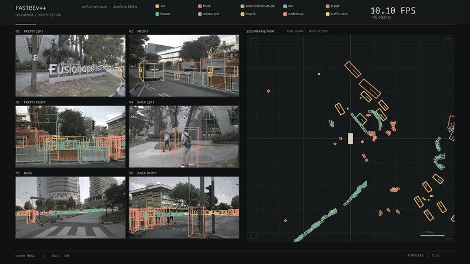

# bevdet-metis

`bevdet-metis` runs six-camera, camera-only 3D object detection on Axelera Metis. It deploys the FastBEV++ network as four INT8 CNN stages on the AIPU, with a C++ host pipeline for camera preparation, camera geometry, feature lifting, exact resize operations and box decoding.

Surround-view 3D perception is useful when a robot or vehicle needs to understand nearby objects and free space from cameras. A bird's-eye-view (BEV) representation combines the six views into one ego-centric grid, where the detector predicts oriented 3D boxes, classes, confidence and planar velocity. This project focuses on the deployment problem: splitting a camera-based BEV model between a low-power edge accelerator and the host while preserving its input, geometry and output conventions.



## Design and execution

The network shares one image backbone across all six cameras; it is invoked once per camera image. CNN execution is on Metis. Camera projection and the BEV transform are geometric operations, not CNN layers, so they run on the host. Two `align_corners` bilinear resizes also stay on the host because the current Voyager compiler does not support that resize convention on the AIPU.

```text
six calibrated camera images
  → resize, normalize, quantize and pad                 [C++ host]
  → shared image backbone + depth/feature prediction ×6 [Metis, INT8]
  → camera projection, indexed feature lift and sum      [C++ host]
  → BEV backbone                                        [Metis, INT8]
  → exact bilinear resize + feature concatenation        [C++ host]
  → BEV neck                                            [Metis, INT8]
  → exact bilinear resize                               [C++ host]
  → detection head                                      [Metis, INT8]
  → CenterPoint decode and rotated NMS                   [C++ host]
```

One shared AxRuntime context manages four models, with one Metis core reserved for each CNN stage. A frame passes through the stages sequentially; the six camera calls share the image core. The implementation does not yet batch cameras or pipeline consecutive frames across cores. Preprocessing and selected host kernels use CPU parallelism and SIMD. The C++ backend owns inference and rendering data flow; Python is used for model export, optional reference inference, validation and presentation.

Each `704×256` camera image produces 59 depth-bin logits and 64 feature channels per image location. The host applies the depth sigmoid and uses each camera's calibration to project those features into a `128×128` BEV grid at 0.8 m resolution, accumulating the vertical slices. The BEV CNN then predicts a 10-class heatmap and box attributes: center offset, height, dimensions, yaw and planar velocity.

## Quick start

The commands below use the environment layout from this development workspace. Override `PYTHON` and `SDK` on another machine.

```bash
make setup       # install Python dependencies into the existing uv environment
make models      # download official checkpoint and export ONNX graphs
make data        # download nuScenes v1.0-mini and retain images/metadata
make build       # build the C++ application
make compile     # calibrate and compile the four CNN stages for Metis
make demo        # run one sample; save results/cpp/demo.png
```

The defaults are `PYTHON=../deeplsd-metis/.venv/bin/python` and `SDK=../voyager-sdk`. For a separate Python environment:

```bash
uv venv --python 3.11 .venv
make setup PYTHON=.venv/bin/python
make models data PYTHON=.venv/bin/python
```

The C++ build requires a C++17 compiler, CMake, pkg-config, OpenCV, yaml-cpp, nlohmann-json, OpenSSL, OpenBLAS and AxRuntime. On Ubuntu, install the system packages with:

```bash
sudo apt install build-essential cmake pkg-config libopencv-dev libyaml-cpp-dev \
  nlohmann-json3-dev libssl-dev libopenblas-dev
```

Metis inference needs a compatible Voyager SDK/AxRuntime installation and connected hardware. `BACKEND=onnx` runs the CPU ONNX reference without Metis; `BACKEND=aipu` selects the Python AxRuntime reference.

## Data and model weights

`make data` downloads the official [nuScenes v1.0-mini](https://www.nuscenes.org/nuscenes) release. The source archive is about 4.17 GB; this project retains roughly 449 MB of camera keyframes and metadata, including calibration, poses and annotations. It does not need LiDAR, radar, maps or sweeps. The default sample is from `scene-0103` in `mini_val`; calibration uses distinct samples from `mini_train`.

`make checkpoint` downloads the official `epoch_20_ema.pth` checkpoint. `make models` does that automatically, verifies its SHA-256, then exports the full ONNX graph and the four CNN partitions using the standalone PyTorch architecture in `python/model.py`. Generated graph hashes and model shapes are recorded in `weights/onnx/provenance.json`. No training repository clone, MMCV, MMDetection or CUDA installation is used.

The dataset, model and derived demonstration imagery have their own distribution terms. See [THIRD_PARTY_NOTICES.md](THIRD_PARTY_NOTICES.md) before redistribution.

## Make commands

| Command | What it does / output |
| --- | --- |
| `make setup` | Install Python requirements in the selected environment |
| `make data` | Download and extract nuScenes v1.0-mini |
| `make checkpoint` | Download and verify the PyTorch checkpoint |
| `make models` | Download checkpoint and export ONNX models |
| `make build` | Build `build/bevdet_metis` and the C++ library |
| `make calibration` | Prepare 32 real rig samples for quantization (default) |
| `make compile` | Calibrate and compile all four CNN stages with Voyager |
| `make demo` | Process one frame and save `results/cpp/demo.png` |
| `make video` | Save a video and detections under `results/cpp/` |
| `make showcase` | Run the selected 300-frame, multi-scene showcase and render a 30-second video |
| `make profile` | Profile without rendering; save timing JSON under `results/cpp/` |
| `make compare` | Compare the C++ pipeline with Python AxRuntime, including tensor traces |
| `make verify BACKEND=onnx` | Check full ONNX against partitions and the PyTorch view transform |
| `make verify BACKEND=aipu` | Compare FP32 reference and INT8 Metis outputs on validation frames |

Common options:

```bash
make video FRAMES=30 START=5 FPS=10
make showcase SHOWCASE_DIR=results/my_showcase
make profile FRAMES=20
make demo BACKEND=onnx
make video BACKEND=aipu
make compile PART=image
make build NATIVE=OFF
```

`BACKEND` defaults to `cpp` and accepts `cpp`, `onnx`, `split` or `aipu`. `FRAMES`, `START`, `FPS`, `CONFIG`, `OUTPUT_DIR`, `PYTHON`, `SDK`, `BUILD_DIR` and `JOBS` can be set on the make command line. See `make help` for defaults. Configuration is in [configs/default.yaml](configs/default.yaml); paths are relative to that YAML file. The video `FPS` setting controls playback cadence, not the inference rate. `make profile` includes JPEG reads and preprocessing, and excludes model loading, rendering and encoding.

## Performance and profiling

On a Ryzen 7 3700X with Voyager/AxRuntime 1.7.0 and a Metis device, the optimized C++ pipeline averaged **99.0 ms per six-camera rig frame (10.10 frames/s)** over three paired trials of 20 `scene-0103` samples. The fixed workload includes the first frame and JPEG reads; it excludes model loading, JSON/tensor export, visualization and encoding.

| Stage | Mean time |
| --- | ---: |
| Preprocessing, including six JPEG reads | 32.2 ms |
| Inference, including Metis calls and host feature transforms | 65.1 ms |
| Box decoding and NMS | 1.7 ms |
| End-to-end pipeline | **99.0 ms** |
| Time inside AxRuntime calls (included in inference) | 58.5 ms |
| Host work across pipeline (pipeline minus AxRuntime) | 40.5 ms |

The C++ host optimizations reduced mean pipeline time from 216.8 ms to 99.0 ms (2.19× faster) and host time from 158.8 ms to 40.5 ms. Fused input preparation and feature-resize kernels avoid large intermediate tensors; the BEV lift no longer materializes a roughly 29 MB voxel volume. These are synchronous per-frame measurements, not batched or pipelined throughput. AxRuntime timing includes transfers and waiting, not only accelerator arithmetic. Detailed profiling counters overlap; do not sum them as independent stages. The trials and settings are in [assets/host_optimization.json](assets/host_optimization.json).

## INT8 output and validation

The C++ optimizations do not alter the compiled INT8 model. On the same 20-frame workload, the optimized and frozen C++ implementations produced exactly the same **775 detections**, and traced raw heads, preprocessed images and projection indices matched bit-for-bit. Full ONNX versus partitioned ONNX also passes on three real rig samples, with a maximum head difference of `1.15e-5`.

INT8 outputs do differ from the FP32 ONNX reference. On three real frames, output-head cosine similarity ranged from 0.997–0.998 for the heatmap, 0.993–0.997 for height and regression, 0.976–0.980 for dimensions, 0.898–0.938 for rotation and 0.944–0.951 for velocity. At the same 0.4 score threshold, the paired frame counts were 33 vs 24, 33 vs 40 and 72 vs 74 (FP32 vs INT8). This indicates that the main detection response is similar while some box attributes and threshold decisions shift after quantization. It is not an mAP/NDS evaluation, and the project does not claim parity with FP32 detection accuracy. Calibration and full dataset-level accuracy evaluation remain open work.

## References and license

- [FastBEV++ paper and source](https://github.com/ymlab/advanced-fastbev), source revision `04c2b3610f7c33ebc323723fe90998121e22cfac`.
- [nuScenes](https://www.nuscenes.org/nuscenes), Caesar et al., CVPR 2020.

Project code is AGPL-3.0-or-later. The adapted model layers retain their Apache-2.0 attribution; model, data, SDK and other incorporated-code notices are detailed in [THIRD_PARTY_NOTICES.md](THIRD_PARTY_NOTICES.md).
